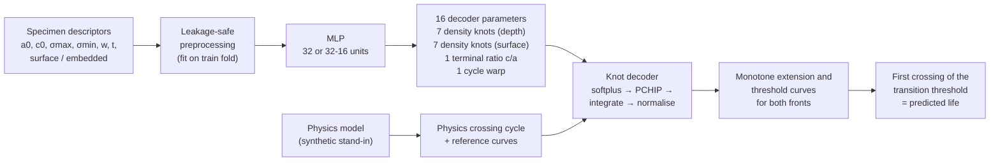

# Physics-informed crack growth

A hybrid neural network that predicts **short-crack growth curves** for
components with manufacturing defects. Instead of predicting a single life
number, the network outputs the parameters of a small *decoder* that turns
them into full crack-growth curves for both crack fronts. The curves are
monotone by construction and are pulled towards a physics model by four
penalty terms.

This repository is a clean, public re-implementation of the method from my
M.Sc. thesis (2026, with an industrial partner). **The experimental data and
the industrial physics model are proprietary and not included.** To keep the
code runnable, both are replaced by synthetic stand-ins (see
[What is synthetic](#what-is-synthetic)).

## Quick start

```bash
python -m venv .venv && source .venv/bin/activate   # Python 3.10-3.12
pip install -r requirements.txt
python -m picg.run          # quick search, about 5 minutes on a laptop CPU
python -m picg.run --full   # full inner search used in the thesis protocol
pytest -q
```

`python -m picg.run` generates 56 synthetic specimens, runs 5-fold nested
cross-validation and prints the blind-fold metrics for the physics baseline
and the hybrid decoder.

## Method



**Decoder (`picg/decoder.py`).** For each specimen the network emits 16
numbers. Softplus makes the 7+7 density knots positive; a shape-preserving
cubic (PCHIP) interpolates them onto an event grid `s ∈ [0, 1.2]`; a
cumulative integral turns density into crack extension, which therefore can
only grow. The depth curve is normalised to reach the transition extension
at `s = 1`, the surface curve is scaled by the bounded terminal ratio, and an
El Haddad-type threshold law maps extension to a threshold curve. The event
axis is mapped to cycles by `N = s · N_physics · exp(warp)` with a bounded
warp, so the network corrects the physics timing instead of replacing it.

**Loss (`picg/losses.py`).**

| Term | What it does |
|---|---|
| MSE of `log1p` cycles | fits the observed life via a differentiable soft first-crossing |
| curve shape | Wasserstein-1 distance between normalised extension curves and the physics reference |
| terminal ratio | Huber loss on the surface/depth extension ratio at `s = 1` |
| threshold concavity | penalises convex bends of the threshold curve at 17 anchor points |
| warp cap | keeps the cycle warp small so timing errors are not absorbed by one scalar |

**Validation (`picg/cv.py`, `picg/model.py`).** Nested cross-validation with
5 outer folds. Inside each outer training set, repeated inner splits score a
grid of loss-weight profiles (Latin hypercube on a log scale) crossed with two
backbones; the simplest candidate within one standard error of the best is
refit on the full outer training set and evaluated once on the blind fold.
Scaling and one-hot encoding are always fit on the training part only.

**Metrics (`picg/metrics.py`).** MAE and RMSE of `log1p` cycles, and the
number of *late* (non-conservative) predictions, where the model predicts a
longer life than observed.

## Thesis results (real data, not reproducible here)

On the 56 experimental specimens, blind outer-fold predictions:

| Model | MAE (log) | RMSE (log) | Late predictions |
|---|---|---|---|
| Physics model | 0.965 | 1.171 | 8 / 56 |
| Hybrid decoder | 0.771 | 1.062 | 29 / 56 |

The hybrid model reduced the MAE by 20.1 %. It also moved from a mostly
conservative physics model to roughly balanced errors, which is the main
trade-off to discuss before using it for design decisions.

The numbers printed by `python -m picg.run` come from synthetic data and are
**not** comparable to these results.

## What is synthetic

* **Physics model (`picg/physics.py`).** A textbook stand-in: an El
  Haddad-type short-crack threshold combined with a Paris-type growth law,
  integrated for the depth and surface fronts with simplified geometry
  factors. All constants are generic illustrative values.
* **Specimen table (`picg/data.py`).** Random initial defect sizes, stresses,
  specimen width and thickness, and defect type. The "observed" life is the
  synthetic physics life times a hidden feature-dependent correction and
  log-normal scatter, so there is something for the network to learn.
  `examples/synthetic_specimens.csv` is one such table
  (`python -m picg.data --out examples/synthetic_specimens.csv`).

Run on your own table with `python -m picg.run --table my_specimens.csv`
(same columns as the example).

## Repository layout

```
picg/
  physics.py   synthetic short-crack model (threshold law + growth integration)
  data.py      synthetic specimen generator, event grid, physics reference curves
  decoder.py   16-parameter knot decoder and network
  losses.py    log-cycle loss and the four physics penalties
  cv.py        outer/inner splits, leakage-safe preprocessing
  model.py     training loop, prediction, inner search, nested-CV runner
  metrics.py   MAE / RMSE in log cycles, late-prediction count
  run.py       end-to-end demo
tests/         decoder monotonicity, split hygiene, metrics
examples/      synthetic specimen table
```

## License

MIT, see [LICENSE](LICENSE).
