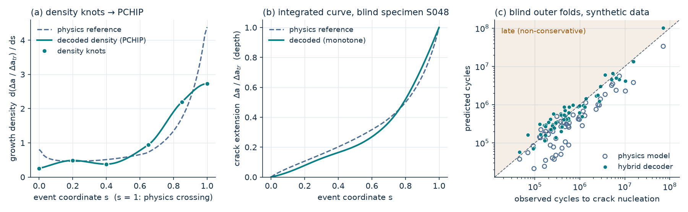
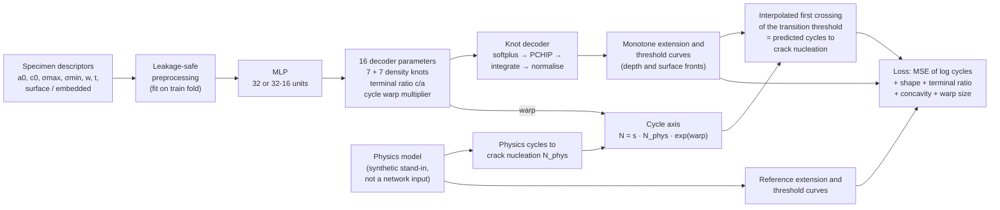

# Physics-informed crack growth

A physics-informed knot decoder that predicts short-crack growth curves and cycles to crack nucleation for components with manufacturing defects.

[](https://www.python.org/)
[](https://www.tensorflow.org/)
[](LICENSE)
[](https://kivanho.github.io)

<picture>
  <source media="(prefers-color-scheme: dark)" srcset="docs/hero_dark.png">
  
</picture>

*Synthetic data only. (a, b) One network trained on outer fold 1, decoding a blind specimen of that fold, shown on `s ≤ 1`, the range the loss sees. (c) Blind outer-fold predictions from `python -m picg.run`. Generated by [`scripts/make_figures.py`](scripts/make_figures.py).*

## What it is / is not

**It is** a clean, public re-implementation of the method from my M.Sc. thesis (2026, with an industrial partner): the knot decoder, the physics-informed loss and the leakage-safe nested cross-validation, runnable end to end on synthetic data.

**It is not** a reproduction of the thesis results. The experimental data are not included, and the industrial partner's implementation of the physics model is not included; both are replaced by synthetic stand-ins. The numbers this code prints say nothing about real-world accuracy, and it is not a validated design tool.

The target throughout is the number of **cycles to crack nucleation**: the first crossing of the short-to-long-crack transition threshold (derived from the long-crack threshold ΔK_th,LC).

## Method



- **The physics model is not an input.** The network sees only specimen descriptors. The physics reference curves supervise the curve shape through the loss, and the physics threshold cycle `N_phys` sets the time scale that the warp multiplier corrects.
- **Monotone by construction** ([`picg/decoder.py`](picg/decoder.py)). Softplus makes the 7 + 7 density knots positive, a shape-preserving cubic (PCHIP) interpolates them on the event grid `s ∈ [0, 1.2]`, and a cumulative integral turns density into crack extension. The depth curve is normalised to reach the transition extension at `s = 1`, the surface curve is scaled by the bounded terminal ratio, and a cyclic R-curve maps extension to threshold.
- **Loss** ([`picg/losses.py`](picg/losses.py)): MSE of log cycles plus four physics penalties: Wasserstein-1 curve-shape distance to the reference, Huber loss on the terminal c/a ratio, convexity of the threshold curve at 17 anchors, and warp size. The concavity term encodes the predominantly concave-down physical threshold curves; it counts only convexity in excess of the reference curve's own, so it is exactly zero on the physics reference (tested).
- **One crossing function** for training and prediction: the first grid point at or above the transition threshold, linearly interpolated with the point before it. It is differentiable almost everywhere, so there is no soft surrogate and no train/predict mismatch.
- **Nested cross-validation** ([`picg/model.py`](picg/model.py), [`picg/cv.py`](picg/cv.py)) with 5 outer folds. Inner splits of each outer training set score loss-weight profiles (default + all-minimum ablation + Latin-hypercube samples on a log scale) crossed with two backbones; the simplest candidate within one standard error (`ddof = 1`) of the best is refit and evaluated once on the blind fold. Scaling and encoding are fit on the training part only.
- **Metrics** ([`picg/metrics.py`](picg/metrics.py)): MAE, RMSE and mean bias of `log1p` cycles, and the number of *late* (non-conservative) predictions, i.e. more predicted cycles than observed.

## Results

### Thesis (real data, not reproducible here)

56 experimental specimens of one material at one nominal stress ratio R = 0.1; blind outer-fold predictions from 5-fold nested cross-validation.

| Model | MAE (log) | RMSE (log) | Late predictions |
|---|---|---|---|
| Physics model | 0.965 | 1.171 | 8 / 56 |
| Hybrid decoder | 0.771 | 1.062 | 29 / 56 |

The hybrid model reduced the MAE by 20.1 %. It also moved from a mostly conservative physics model to roughly balanced errors, which is the main trade-off to discuss before using it for design decisions.

### Synthetic demo (pipeline check, not a result)

Output of `python -m picg.run` (quick search, seed 2026):

```
56 synthetic specimens | 5 outer folds | 4 candidates x 2 inner splits per fold
model                   MAE (log)  RMSE (log)  bias (log)     late
physics baseline            0.773       0.974      -0.725     7/56
hybrid decoder              0.350       0.429      +0.027    29/56
MAE change vs physics: -54.7 %
```

The synthetic task is much easier than the real one: the hidden physics-model error is a smooth function of the inputs, and the only other error is log-normal scatter with σ = 0.30, i.e. a noise floor of about 0.24 MAE (log). The larger improvement than in the thesis therefore shows that the pipeline works, not that the method is better than reported. Reruns on another machine or TensorFlow version can differ slightly in the last digits.

## Quick start

```bash
python3.12 -m venv .venv && source .venv/bin/activate   # Python 3.11 or 3.12
pip install -r requirements.txt
python -m picg.run          # quick search, about 5-6 minutes on an idle laptop CPU
python -m picg.run --full   # full search: 8 candidates x 3 inner splits, much slower
pytest -q                   # up to about 2 minutes, mostly TensorFlow start-up
python scripts/make_figures.py   # redraw docs/hero_*.png
```

The quick search uses the default loss weights plus one sampled profile and leaves out the all-minimum ablation; `--full` uses default + ablation + two samples. Run on your own table with `python -m picg.run --table my_specimens.csv` (same columns as [`examples/synthetic_specimens.csv`](examples/synthetic_specimens.csv)).

## Repository layout

| Path | Contents |
|---|---|
| `picg/physics.py` | synthetic short-crack model: cyclic R-curve threshold + Paris-type growth for both fronts |
| `picg/data.py` | synthetic specimen generator, event grid, physics reference curves |
| `picg/decoder.py` | 16-parameter knot decoder and network |
| `picg/losses.py` | first-crossing function, log-cycle loss, four physics penalties |
| `picg/cv.py` | outer/inner splits, leakage-safe preprocessing |
| `picg/model.py` | training loop, prediction, inner search, nested-CV runner |
| `picg/metrics.py` | MAE / RMSE / bias in log cycles, late-prediction count |
| `picg/run.py` | end-to-end demo |
| `scripts/make_figures.py` | README figure (light and dark) |
| `tests/` | decoder monotonicity, crossing, concavity penalty, split hygiene, metrics |
| `examples/` | synthetic specimen table and the blind predictions behind the figure |
| `docs/` | rendered figures |

## Limitations

- **Synthetic stand-ins.** The physics model is a textbook substitute: a cyclic R-curve (threshold build-up with crack extension from the defect, Chapetti / McEvily-type behaviour, here with a square-root form) plus a Paris-type law with simplified geometry factors; the transition threshold is 95 % of ΔK_th,LC. All constants are illustrative, not material data. Unlike the thesis data, the synthetic campaign varies the stress ratio (R ∈ {-1, 0.1, 0.3}).
- **The warp carries the timing.** Because the depth front reaches the transition threshold exactly at `s = 1`, the predicted crossing moves only through the warp multiplier, or earlier when the surface front is scaled above the depth front (terminal ratio > 1). The knots shape the curves; they do not move the crossing.
- **Post-transition tail.** The segment `s ∈ (1, 1.2]` is a fixed 2,000-cycle tail that no loss term sees, so the last knot is only weakly identified (through the PCHIP slope at `s = 1`). Do not interpret the decoded tail.
- **Small data.** 56 specimens give wide uncertainty on any fold-level metric, and the model provides no prediction intervals. Roughly half of the hybrid predictions are late, on real and synthetic data alike; a conservative margin would be needed before any design use.
- **Determinism.** Seeds are fixed and TensorFlow op determinism is enabled; reruns can still differ slightly across platforms and TensorFlow releases.

## Citation / context

Method from the M.Sc. thesis *Physics-Informed Machine Learning for Modeling Short Crack Growth in Gas Turbine Components with Manufacturing Defects* (Kien van Ho, 2026), written with an industrial partner. This repository is an independent re-implementation on synthetic data.

```bibtex
@software{vanho2026picg,
  author = {van Ho, Kien},
  title  = {Physics-informed crack growth: a knot decoder for short-crack growth (synthetic demo)},
  year   = {2026},
  url    = {https://github.com/kivanho/physics-informed-crack-growth}
}
```

More projects: [kivanho.github.io](https://kivanho.github.io). MIT licence, see [LICENSE](LICENSE).
